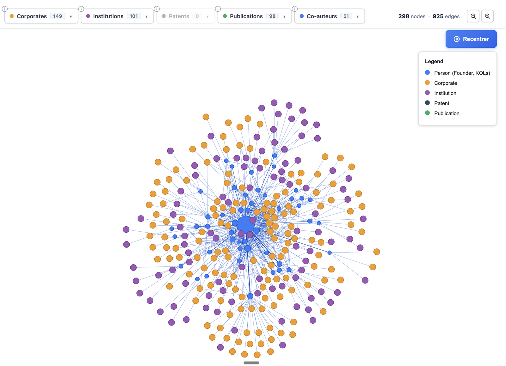
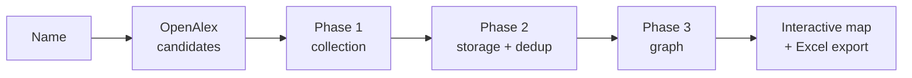

# Scholarmap

**Map a researcher's scientific and industrial network from public sources.**

[](LICENSE)
[](https://github.com/Hsn9403/scholarmap/stargazers)


Type a name, pick the right profile among the candidates, wait for the pipeline, and get an
interactive map of who the researcher works with: co-authors, co-inventors, institutions,
and the companies that sponsor their trials, pay them, hold their patents or cite them.
Every link in the map is backed by a document you can open.



Scholarmap is an open-source tool for **scientific due diligence**, **KOL mapping** (key
opinion leaders) and **research network analysis**. It joins OpenAlex, Google Scholar,
Google Patents, ClinicalTrials.gov, CMS Open Payments and Transparence Santé into a single
**co-authorship and industry-ties graph**.

**If Scholarmap saves you time, please [star the repository](https://github.com/Hsn9403/scholarmap).**
Stars are how other researchers, investors and tech-transfer teams find it.

## Try it in your terminal

Python 3.12 and three commands. No database to install, no account, no API key required:

```bash
git clone https://github.com/Hsn9403/scholarmap.git && cd scholarmap
python3 -m venv .venv && source .venv/bin/activate && pip install -r requirements.txt
python scholarmap.py "Yann LeCun"
```

```
✓ Recherche de « Yann LeCun » sur OpenAlex 1 s

  1. Yann LeCun
     Dartmouth College · NEC (Japan)
     581 publications · 262442 citations
  2. Yann LeCun
     Machine Science · New York University
     3 publications · 0 citations

Quel profil analyser ? [1-2, q pour quitter] 1

✓ Collecte : publications, co-auteurs, brevets, essais cliniques, paiements déclarés 9 s
✓ Déduplication et stockage 1 s
⠏ Construction de la carte du réseau · profils des co-auteurs (OpenAlex) [██████████████░░░░░░] 35/51 4 s

Carte prête en 0.3 min : output/yann_lecun_network.html
```

The map opens in your browser. Use the filters at the top, and click a company to see the
path that links it to the researcher.

| Option | Effect |
|---|---|
| `--quick` | lighter analysis (fewer publications and co-authors, no enrichment), a few seconds |
| `-y` | take the first profile without asking |
| `--no-open` | do not open the browser |
| `-v` | show the pipeline logs |

Without any key you get publications, co-authors, institutions, clinical trials and
declared industry payments. Two optional keys add more:

- `SERPAPI_KEY` adds **patents**, co-inventors and the companies that hold or cite them.
  Free, see below.
- `OPENAI_API_KEY` adds AI reclassification of companies and institutions (paid, optional).

Data is stored in a local SQLite file (`scholarmap.db`); set `DATABASE_URL` to use
PostgreSQL instead.

### Getting a free SerpAPI key

[SerpAPI](https://serpapi.com) is the service Scholarmap uses to query Google Patents. Its
free plan is enough to try the tool:

1. Create an account at [serpapi.com/users/sign_up](https://serpapi.com/users/sign_up) and
   confirm your email.
2. Copy your **Private API Key** from the dashboard:
   [serpapi.com/manage-api-key](https://serpapi.com/manage-api-key).
3. Put it in a `.env` file at the root of the project:

   ```bash
   cp .env.example .env
   # then edit .env:  SERPAPI_KEY=your_private_key
   ```

   or, for the current terminal session only: `export SERPAPI_KEY=your_private_key`.
4. Run `python scholarmap.py "Name"` again: patents now appear in the map, and the last line
   tells you how many SerpAPI searches the analysis used.

**What the free plan covers.** 250 searches per month and 50 per hour, with only successful
searches counted ([pricing](https://serpapi.com/pricing), checked October 2026). In our
measurements a full analysis uses about **11 to 20 searches** (one patent search for the
researcher, one for each of their ten most-published co-authors, a few name variants), so
roughly **12 to 20 analyses a month**. With `--quick`, co-author patents are skipped and an
analysis uses **1 or 2 searches**.

Responses are cached locally (`src/api/cassettes/`): running the same analysis again costs
nothing. Your key stays on your machine; it is never sent anywhere except to SerpAPI, and
`.env` is git-ignored so it cannot be committed by mistake.

## Who it is for

- **Investors and analysts** running scientific due diligence on a deeptech or healthtech founder
- **Business development and medical affairs teams** mapping key opinion leaders in a therapeutic area
- **Tech-transfer offices** looking for the companies already close to a lab
- **Researchers** who want to see their own collaboration network and how industry connects to it

---

## How it works



1. **Search.** The name is matched against OpenAlex author profiles. Homonyms are common,
   so you choose the right one from its affiliations, works count and citations.
2. **Collect.** Publications, patents, clinical trials and disclosed industry payments are
   pulled for the researcher and their closest co-authors.
3. **Resolve.** The hard part is deciding that two records describe the same person.
   `A Nedelec`, `Alice Nedelec` and `Alice Nedelec Mercier` may or may not be one
   researcher, and getting it wrong silently corrupts the whole graph. Disambiguation runs
   across sources (OpenAlex IDs, shared documents, name + affiliation, composite scoring)
   rather than trusting any single one.
4. **Map.** The network is rendered with vis.js. You can filter by corporates, institutions,
   patents, publications or co-authors, keep only direct links, search inside each list,
   and click a company to see the path that connects it to the researcher.

| Source | What it contributes |
|---|---|
| [OpenAlex](https://openalex.org) | publications, author identity, affiliations, topics |
| Google Scholar (via SerpAPI) | citation counts, h-index, profile resolution |
| Google Patents (via SerpAPI) | patents, assignees, co-inventors, citation chains |
| [ClinicalTrials.gov](https://clinicaltrials.gov) | trials, sponsors, investigator roles |
| [CMS Open Payments](https://openpaymentsdata.cms.gov) | disclosed payments from industry to US clinicians |
| [Transparence Santé](https://www.transparence.sante.gouv.fr) | disclosed payments from industry to French health professionals |
| [Crossref](https://www.crossref.org) | author-name expansion (initials → full names) |
| [ROR](https://ror.org) | institution normalisation |

---

## Stack

- **Backend:** Flask 3 (JSON API only), SQLAlchemy 2, PostgreSQL, Gunicorn
- **Frontend:** Next.js 16 / React 19 in `frontend/`, proxying `/api` and `/graphs` to Flask
- **Graphs:** pyvis / vis.js, served in an iframe
- **Reports:** openpyxl
- **i18n:** French and English, one source of truth in `webapp/translations/`

## Security

There are no user accounts. Anyone who can reach the instance can run an analysis, so the
protection of your API quotas is the per-IP rate limit on `/api/analyze/start`
(`ANALYSIS_RATE_LIMIT`, 5 analyses per IP per day by default; only analyses that actually
start are counted, and viewing an existing report is free) and on the other endpoints that call paid
or rate-limited APIs.

- **Expose only the frontend.** Flask must sit behind the Next.js proxy (and optionally
  nginx); set `TRUSTED_PROXY_HOPS` to the number of proxies so the rate limit sees the real
  client IP. If the Flask port is reachable directly, `X-Forwarded-For` can be forged.
- **Graphs are sandboxed.** They embed strings from external APIs (titles, company names,
  trial sponsors). Those strings are HTML-escaped, and `/graphs/*` is also served with a
  `Content-Security-Policy: sandbox` header, so a graph runs in an opaque origin with no
  access to the site even if something slipped through.
- **No CORS.** The API only answers same-origin requests, so another site cannot make its
  visitors' browsers launch analyses on your quota.
- **Debug is off by default** and the development server binds to `127.0.0.1`.

Found a vulnerability? Please open a private security advisory on GitHub rather than a
public issue.

---

## Running the web app

The terminal version above is enough to try Scholarmap. To host the web interface
(search page, loading screen, report with the embedded map), you need Python 3.12,
Node 20+, pnpm, PostgreSQL and a SerpAPI key.

```bash
python -m venv .venv && source .venv/bin/activate
pip install -r requirements.txt

cp .env.example .env              # then fill in DATABASE_URL, SERPAPI_KEY, FLASK_SECRET_KEY
createdb scholarmap
python -m src.database.init_db    # creates the tables

python webapp/app.py              # API on http://localhost:5001
```

In a second terminal:

```bash
cd frontend && pnpm install && pnpm dev   # http://localhost:3000
```

Set `SCHOLARMAP_API_URL` when building the frontend if the API does not run on
`localhost:5001`. In production, run the API with the `Procfile` command (Gunicorn) and the
frontend with `pnpm build && pnpm start`.

### API

| Call | Purpose |
|---|---|
| `POST /api/analyze/resolve` `{researcher_name}` | OpenAlex candidates, or an existing report |
| `POST /api/analyze/start` `{researcher_name, openalex_id}` | launches the pipeline, returns `task_id` |
| `GET /api/status/<task_id>` | progress for the loading screen |
| `GET /api/report/<name>` | metrics and the URL of the network map |
| `GET /graphs/db/<slug>` | the interactive map itself |

### Tests

```bash
pytest src/tests -q
```

---

## Data

The repository contains no researcher data, no generated reports and no API response caches
beyond a few test fixtures. Every source is public, but an analysis of a named person is
derived personal data: if you host an instance, you are responsible for what it stores and
for honouring removal requests.

Docstring examples and test fixtures use invented names. If a name in here looks like a real
person, it is a fixture rather than a claim about anyone.

---

## Contributing

Issues and pull requests are welcome: new data sources, better disambiguation, other
languages. Open an issue first for anything large so we can agree on the approach.

## Support the project

Scholarmap is free and open source. The simplest way to help is to
**[give it a star on GitHub](https://github.com/Hsn9403/scholarmap)**, and to share it with
someone who maps research networks by hand.

## Citing

If you use Scholarmap in academic work, use the **Cite this repository** button on GitHub
(it reads [`CITATION.cff`](CITATION.cff)).

## Licence

[MIT](LICENSE).
