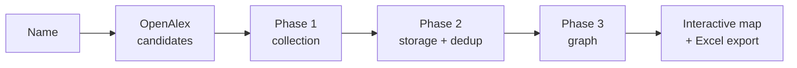

# Scholarmap

**Map a researcher's scientific and industrial network from public sources.**

Type a name, pick the right profile among the candidates, wait for the pipeline, and get an
interactive map of who the researcher works with: co-authors, co-inventors, institutions,
and the companies that sponsor their trials, pay them, hold their patents or cite them.
Every link in the map is backed by a document you can open.

---

## How it works



1. **Search.** The name is matched against OpenAlex author profiles. Homonyms are common,
   so you choose the right one from its affiliations, works count and citations.
2. **Collect.** Publications, patents, clinical trials and disclosed industry payments are
   pulled for the researcher and their closest co-authors.
3. **Resolve.** The hard part is deciding that two records describe the same person.
   `A Nedelec`, `Alice Nedelec` and `Alice Nedelec Mercier` may or may not be one
   researcher, and getting it wrong silently corrupts the whole graph. Disambiguation runs
   across sources (OpenAlex IDs, shared documents, name + affiliation, composite scoring)
   rather than trusting any single one.
4. **Map.** The network is rendered with vis.js. You can filter by corporates, institutions,
   patents, publications or co-authors, keep only direct links, search inside each list,
   and click a company to see the path that connects it to the researcher.

| Source | What it contributes |
|---|---|
| [OpenAlex](https://openalex.org) | publications, author identity, affiliations, topics |
| Google Scholar (via SerpAPI) | citation counts, h-index, profile resolution |
| Google Patents (via SerpAPI) | patents, assignees, co-inventors, citation chains |
| [ClinicalTrials.gov](https://clinicaltrials.gov) | trials, sponsors, investigator roles |
| [CMS Open Payments](https://openpaymentsdata.cms.gov) | disclosed payments from industry to US clinicians |
| [Transparence Santé](https://www.transparence.sante.gouv.fr) | disclosed payments from industry to French health professionals |
| [Crossref](https://www.crossref.org) | author-name expansion (initials → full names) |
| [ROR](https://ror.org) | institution normalisation |

---

## Stack

- **Backend:** Flask 3 (JSON API only), SQLAlchemy 2, PostgreSQL, Gunicorn
- **Frontend:** Next.js 16 / React 19 in `frontend/`, proxying `/api` and `/graphs` to Flask
- **Graphs:** pyvis / vis.js, served in an iframe
- **Reports:** openpyxl
- **i18n:** French and English, one source of truth in `webapp/translations/`

There are no user accounts. Anyone who can reach the instance can run an analysis, so the
only protection of your API quotas is the per-IP rate limit on `/api/analyze/start`
(`ANALYSIS_RATE_LIMIT`, 10 per hour by default).

---

## Running it

Requirements: Python 3.12, Node 20+, pnpm, PostgreSQL, a SerpAPI key.

```bash
python -m venv .venv && source .venv/bin/activate
pip install -r requirements.txt

cp .env.example .env              # then fill in DATABASE_URL, SERPAPI_KEY, FLASK_SECRET_KEY
createdb scholarmap
python -m src.database.init_db    # creates the tables

python webapp/app.py              # API on http://localhost:5001
```

In a second terminal:

```bash
cd frontend && pnpm install && pnpm dev   # http://localhost:3000
```

Set `SCHOLARMAP_API_URL` when building the frontend if the API does not run on
`localhost:5001`. In production, run the API with the `Procfile` command (Gunicorn) and the
frontend with `pnpm build && pnpm start`.

### API

| Call | Purpose |
|---|---|
| `POST /api/analyze/resolve` `{researcher_name}` | OpenAlex candidates, or an existing report |
| `POST /api/analyze/start` `{researcher_name, openalex_id}` | launches the pipeline, returns `task_id` |
| `GET /api/status/<task_id>` | progress for the loading screen |
| `GET /api/report/<name>` | metrics and the URL of the network map |
| `GET /graphs/db/<slug>` | the interactive map itself |

### Tests

```bash
pytest src/tests -q
```

---

## Data

The repository contains no researcher data, no generated reports and no API response caches
beyond a few test fixtures. Every source is public, but an analysis of a named person is
derived personal data: if you host an instance, you are responsible for what it stores and
for honouring removal requests.

Docstring examples and test fixtures use invented names. If a name in here looks like a real
person, it is a fixture rather than a claim about anyone.

---

## Licence

[MIT](LICENSE).
